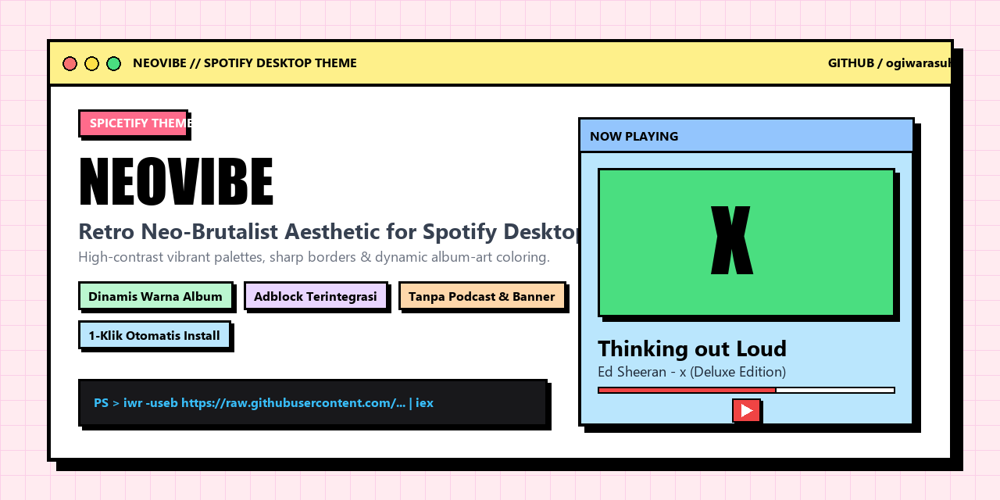

# NeoVibe — Spotify Neobrutalism Theme

<p align="center">
  
</p>

> Tema Spotify modern berbasis Neobrutalism dengan Dynamic Album Art Colors dan All-In-One Built-In Extensions (Adblock, Hide Podcasts, No Controls).

---

## Daftar Isi
- [Fitur Utama](#fitur-utama)
- [Prasyarat](#prasyarat)
- [Instalasi Cepat (Pengguna Awam)](#instalasi-cepat-pengguna-awam)
- [Instalasi Manual (Langkah demi Langkah)](#instalasi-manual-langkah-demi-langkah)
  - [Langkah 1: Pasang Spicetify CLI](#langkah-1-pasang-spicetify-cli)
  - [Langkah 2: Unduh Tema NeoVibe](#langkah-2-unduh-tema-neovibe)
  - [Langkah 3: Terapkan Tema](#langkah-3-terapkan-tema)
- [Panduan Penggunaan](#panduan-penggunaan)
- [Panduan Uninstall Bersih (Clean Reset)](#panduan-uninstall-bersih-clean-reset)
- [Penyelesaian Masalah (FAQ)](#penyelesaian-masalah-faq)

---

## Fitur Utama

- **Desain Neobrutalism Autentik**:
  - Sudut tajam presisi (*0px sharp corners*).
  - Garis batas hitam pekat (*crisp borders*) dengan bayangan padat (*hard offset shadow*).
  - Tipografi kontras tinggi yang bersih dan mudah dibaca.

- **Mode Warna Album Dinamis (Real-Time Dynamic Album Art Color)**:
  - Palet warna Spotify (latar belakang, kartu, playbar, tombol) secara otomatis diekstraksi dan menyesuaikan diri dengan cover album musik yang sedang diputar.
  - Dilengkapi transisi warna halus (*smooth transition*) pada setiap pergantian lagu (*song change*).

- **In-App Color Switcher**:
  - Menu *dropdown* pemilihan tema langsung di antarmuka atas Spotify (di sebelah tombol notifikasi).
  - Perpindahan skema warna instan tanpa perlu memuat ulang aplikasi atau menyunting berkas konfigurasi.
  - Pilihan skema bawaan:
    - `Warna Album (Dinamis)`
    - `Neo-Multicolor (Asli)`
    - `Neo-Yellow`
    - `Neo-Blue`
    - `Neo-Green`
    - `Neo-Orange`
    - `Neo-Red`
    - `Pink (Original)`

- **All-In-One Built-In Extensions (Terintegrasi Penuh)**:
  - **Adblock (oleh `rxri`)**: Memblokir iklan audio, video, serta banner promosi.
  - **Hide Podcasts (oleh `theRealPadster`)**: Menyembunyikan konten podcast dan buku audio agar antarmuka Spotify murni berfokus pada musik.
  - **No Controls (oleh `ohitstom`)**: Menyembunyikan tombol kontrol jendela bawaan (*minimize*, *maximize*, *close*) pada bilah judul (*titlebar*) untuk tampilan yang minimalis dan terpadu. Tekan tombol `F8` pada keyboard untuk memunculkan atau menyembunyikan tombol kontrol sewaktu-waktu.

---

## Prasyarat

Tema NeoVibe didesain dan dioptimalkan secara presisi untuk **Spotify Desktop v1.2.77.358 (LTS)**:

- **Wajib Menggunakan Spotify v1.2.77.358 (LTS)**:
  - Versi terbaru Spotify (v1.3.x+) sering merombak struktur antarmuka internal (DOM/XPUI) secara drastis sehingga merusak penataan tata letak tema modifikasi.
  - Versi `1.2.77.358` adalah versi LTS yang terbukti paling stabil, bebas bug, dan kompatibel 100% dengan Spicetify.
- **Otomatis Melalui Instalasi Cepat (Direkomendasikan)**:
  - Anda **tidak perlu repot mencari atau memasang manual**. Jika menggunakan [Instalasi Cepat](#instalasi-cepat-pengguna-awam), skrip akan otomatis mendeteksi versi Spotify Anda, mengunduh installer resmi `Spotify_1.2.77.358.exe`, memasangnya, dan mengunci pembaruan otomatis Spotify agar tema awet permanen.
- **Bagi Pengguna Instalasi Manual**:
  - Jika ingin memasang secara manual, Anda wajib mengunduh installer resmi versi ini terlebih dahulu:
    👉 [Unduh Spotify v1.2.77.358 LTS Installer (120 MB)](https://github.com/ogiwarasuha/NeoVibe/releases/download/v1.0.0/Spotify_1.2.77.358.exe) (atau melalui tab [GitHub Releases](https://github.com/ogiwarasuha/NeoVibe/releases)).
  - **Penting:** Jangan menggunakan versi dari Microsoft Store dan jangan mengunduh dari situs umum `spotify.com` (karena installer online di sana otomatis memasang versi terbaru yang tidak stabil untuk tema).

---

## Instalasi Cepat (Pengguna Awam)

Bagi Anda yang menginginkan proses instalasi otomatis tanpa perlu menyalin berkas secara manual, gunakan salah satu pilihan berikut:

### Pilihan 1: Jalankan Satu Perintah di PowerShell
1. Buka **PowerShell** (tekan tombol `Windows`, ketik `PowerShell`, lalu tekan `Enter`).
2. Salin dan tempel perintah satu baris berikut, kemudian tekan `Enter`:

```powershell
iwr -useb https://raw.githubusercontent.com/ogiwarasuha/NeoVibe/main/install.ps1 | iex
```

*Skrip ini bekerja secara All-In-One & Clean-Slate:*
- **Membersihkan sistem secara total**: Menghentikan proses yang aktif, menghapus Spotify versi Microsoft Store (UWP) maupun installer lama, serta membersihkan sisa konfigurasi Spicetify lama yang berpotensi memicu konflik (*bug/error*).
- **Memasang Spotify v1.2.77.358 LTS**: Mengunduh dan mengekstrak versi LTS yang bersih dan terbukti stabil.
- **Mengunci pembaruan otomatis Spotify** secara permanen agar tema tidak rusak atau tertimpa versi baru.
- **Memasang Spicetify CLI resmi terbaru** secara otomatis tanpa *prompt* interaktif.
- **Mengunduh dan menerapkan tema NeoVibe** langsung ke Spotify Anda.

### Pilihan 2: Unduh Berkas Installer Otomatis
1. [Unduh Berkas install.bat](https://raw.githubusercontent.com/ogiwarasuha/NeoVibe/main/install.bat)
2. Klik dua kali berkas `install.bat` yang baru saja diunduh.
3. Jendela instalasi akan berjalan secara otomatis hingga tema NeoVibe aktif di Spotify.

---

## Instalasi Manual (Langkah demi Langkah)

Bagi pengguna yang ingin memasang dan mengonfigurasi tema secara mandiri:

### Langkah 1: Pasang Spicetify CLI

Jika Anda belum pernah memasang Spicetify, buka terminal:

**Windows (PowerShell):**
```powershell
iwr -useb https://raw.githubusercontent.com/spicetify/cli/main/install.ps1 | iex
```

**macOS / Linux:**
```bash
curl -fsSL https://raw.githubusercontent.com/spicetify/cli/main/install.sh | sh
```

---

### Langkah 2: Unduh Tema NeoVibe

Pilih salah satu metode berikut:

#### Metode A: Menggunakan Git Clone (Direkomendasikan)
Buka terminal dan jalankan perintah satu baris berikut untuk meng-clone repositori langsung ke direktori tema Spicetify:

**Windows (PowerShell):**
```powershell
git clone https://github.com/ogiwarasuha/NeoVibe.git "$env:APPDATA\spicetify\Themes\NeoVibe"
```

**macOS / Linux:**
```bash
git clone https://github.com/ogiwarasuha/NeoVibe.git ~/.config/spicetify/Themes/NeoVibe
```

#### Metode B: Unduh Berkas ZIP Tema
1. [Klik di sini untuk mengunduh berkas tema (ZIP)](https://github.com/ogiwarasuha/NeoVibe/archive/refs/heads/main.zip) atau klik tombol **Code** -> **Download ZIP** pada halaman repositori.
2. Ekstrak berkas ZIP yang telah diunduh.
3. Ubah nama folder hasil ekstraksi menjadi **`NeoVibe`** (jika sebelumnya bernama `NeoVibe-main`).
4. Buka direktori tema Spicetify:
   - Tekan pintasan `Windows + R`.
   - Ketik `%appdata%\spicetify\Themes` lalu tekan `Enter`.
5. Pindahkan folder **`NeoVibe`** ke dalam direktori tersebut.

Pastikan struktur direktori tersusun sebagai berikut:
```text
spicetify/
└── Themes/
    └── NeoVibe/
        ├── color.ini
        ├── user.css
        ├── theme.js
        ├── install.bat
        ├── install.ps1
        └── README.md
```

---

### Langkah 3: Terapkan Tema

Buka kembali jendela **PowerShell** dan jalankan perintah berikut secara berurutan:

```powershell
spicetify config current_theme NeoVibe
spicetify config inject_theme_js 1
spicetify config inject_css 1
spicetify config replace_colors 1
spicetify backup apply
```

Spotify akan otomatis memuat ulang dan membuka antarmuka dengan tema NeoVibe.

---

## Panduan Penggunaan

### 1. Mengganti Skema Warna
1. Arahkan kursor ke bilah atas jendela Spotify, tepat di sebelah kiri tombol notifikasi.
2. Klik tombol nama skema warna yang sedang aktif.
3. Pilih salah satu skema dari menu *dropdown*.
4. Jika memilih **Warna Album (Dinamis)**, putar lagu apa saja untuk melihat warna tema bertransformasi mengikuti artwork album lagu yang sedang berjalan.

### 2. Mengontrol Tombol Jendela (Minimize / Maximize / Close)
- Tema menyembunyikan tombol kontrol jendela bawaan sistem untuk mempertahankan keselarasan estetika.
- Untuk menampilkan kembali tombol kontrol jendela, tekan tombol **`F8`** pada keyboard.
- Tekan **`F8`** sekali lagi untuk menyembunyikannya kembali.
- Alternatif pintasan keyboard standar Windows:
  - `Alt + F4` : Menutup aplikasi.
  - `Windows + Panah Bawah` : Me-minimize jendela.

---

## Panduan Uninstall Bersih (Clean Reset)

Jika Anda ingin menghapus tema NeoVibe dan mengembalikan Spotify ke kondisi murni bawaan (*stock/original*), pilih salah satu metode berikut:

### Pilihan 1: Uninstall Otomatis (1 Baris Perintah PowerShell)

Buka **PowerShell** dan jalankan perintah satu baris berikut:

```powershell
iwr -useb https://raw.githubusercontent.com/ogiwarasuha/NeoVibe/main/uninstall.ps1 | iex
```

*Skrip ini secara otomatis akan:*
1. Mengembalikan Spotify ke tampilan standar (*stock*).
2. Membuka kembali kunci pembaruan otomatis Spotify.
3. Menghapus folder tema `NeoVibe`.
4. Membersihkan sisa *cache* modifikasi.

---

### Pilihan 2: Uninstall Manual (Langkah demi Langkah)

Bagi Anda yang ingin menghapus modifikasi secara mandiri melalui PowerShell:

#### Langkah 1: Kembalikan Berkas Spotify ke Bawaan
Jalankan perintah berikut di PowerShell untuk melepas modifikasi Spicetify:
```powershell
spicetify restore
```

#### Langkah 2: Buka Kunci Pembaruan Otomatis Spotify
Jika pembaruan otomatis sebelumnya dikunci, buka kuncinya kembali dengan menjalankan perintah berikut:
```powershell
$localUpdate = "$env:LOCALAPPDATA\Spotify\Update"
$roamingUpdate = "$env:APPDATA\Spotify\SpotifyUpdate.exe"
if (Test-Path $localUpdate) { icacls $localUpdate /reset /q; Remove-Item $localUpdate -Force }
if (Test-Path $roamingUpdate) { icacls $roamingUpdate /reset /q; Remove-Item $roamingUpdate -Force }
```

#### Langkah 3: Hapus Berkas Tema NeoVibe
Hapus folder tema `NeoVibe` dari direktori Spicetify:
```powershell
Remove-Item "$env:APPDATA\spicetify\Themes\NeoVibe" -Recurse -Force -ErrorAction SilentlyContinue
```

#### Langkah 4: Pembersihan Total Manual (Hapus Spotify & Spicetify Bersih)
Jika instalasi di komputer Anda atau rekan Anda bermasalah karena sisa Spotify Microsoft Store atau Spicetify lama, jalankan pembersihan total berikut di PowerShell:
```powershell
# 1. Hentikan semua proses
Stop-Process -Name Spotify, SpotifyUpdate, spicetify -Force -ErrorAction SilentlyContinue

# 2. Hapus versi Microsoft Store / Winget
Get-AppxPackage -AllUsers *Spotify* | Remove-AppxPackage -AllUsers -ErrorAction SilentlyContinue
Get-AppxPackage *Spotify* | Remove-AppxPackage -ErrorAction SilentlyContinue
winget uninstall --id Spotify.Spotify -e --silent 2>$null

# 3. Reset hak akses dan hapus folder Spotify
icacls "$env:LOCALAPPDATA\Spotify" /reset /t /c /q 2>$null
Remove-Item "$env:LOCALAPPDATA\Spotify" -Recurse -Force -ErrorAction SilentlyContinue
icacls "$env:APPDATA\Spotify" /reset /t /c /q 2>$null
Remove-Item "$env:APPDATA\Spotify" -Recurse -Force -ErrorAction SilentlyContinue

# 4. Hapus folder Spicetify lama
Remove-Item "$env:LOCALAPPDATA\spicetify" -Recurse -Force -ErrorAction SilentlyContinue
Remove-Item "$env:APPDATA\spicetify" -Recurse -Force -ErrorAction SilentlyContinue
```

---

## Penyelesaian Masalah (FAQ)

#### Apakah pembaruan otomatis Spotify dapat merusak tema?
Secara default, Spotify sering memperbarui versinya di latar belakang. Namun, jika Anda memasang tema ini menggunakan skrip otomatis `install.ps1` atau `install.bat`, pembaruan otomatis Spotify sudah dikunci secara permanen. Jika suatu saat Spotify Anda tidak sengaja terbarui kembali ke versi baru, cukup jalankan kembali `install.ps1` untuk mengembalikan ke versi 1.2.77.358 LTS yang stabil.

#### Muncul galat `Spotify path is not valid` saat menjalankan perintah?
Hal ini umumnya terjadi jika Spotify terpasang dari Microsoft Store. Hapus versi tersebut dan pasang installer resmi Spotify v1.2.77.358 dari [GitHub Releases NeoVibe](https://github.com/ogiwarasuha/NeoVibe/releases/download/v1.0.0/Spotify_1.2.77.358.exe).

#### Bagaimana cara mengembalikan Spotify ke tampilan bawaan (uninstall tema)?
Untuk mengembalikan Spotify ke kondisi default, jalankan perintah:
```powershell
spicetify restore
```

---

<p align="center">
  NeoVibe Theme &mdash; Dibuat untuk komunitas Spicetify dan penikmat estetika Neobrutalism.
</p>
